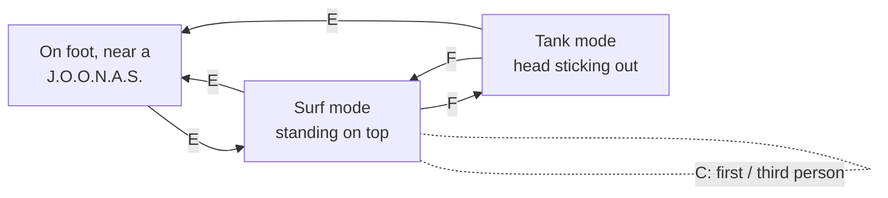

# Riding

| Key | What it does |
|---|---|
| **E** | Mount a nearby J.O.O.N.A.S. (look at it), or dismount |
| **F** | While riding: switch between Surf mode and Tank mode |
| **C** | While riding: cycle between first-person and third-person views |

## The two modes

- **Surf mode**: you stand on top of the J.O.O.N.A.S.
- **Tank mode**: you're lowered into it, with only your head sticking out.

## Remembered

Your last Surf/Tank choice and your mounted camera view are remembered between rides and between game sessions, in
`BepInEx/config/JoonasJoyride.preferences`.

## What it doesn't do

You're a passenger: riding doesn't change how a J.O.O.N.A.S. cleans, and you can't steer it. It works anywhere on the
moon, using each robot's own "up" so you sit right on any part of the surface.
